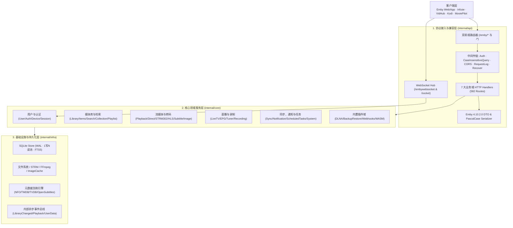

# 01. 系统总体架构与技术选型

[← 返回文档中心](../README.md)

## 1. 设计目标与核心原则

1. **协议语义与功能一致（不照搬内部实现）**：以 Emby Server `4.10.2.0` 的 582 条 HTTP API（含核心 551 条 + 内置插件 31 条）及 WebSocket 会话协议为对外契约，确保**接口语义、行为结果与客户端体验完全一致**；但**内部实现完全自主设计**（不复刻 Emby 历史包袱与 .NET 内部架构，采用更现代高效的 Go 并发、SQLite 规范化表结构、FTS5 检索与插件化内核）。同时坚持 **Domain 领域层与协议适配层彻底解耦**，既保证 Emby 协议零入侵兼容，也允许为自研现代 Web 端与未来生态按需扩展增量能力。
2. **高可用、高性能与极致交互**：
   - **单文件零外部依赖**：纯 Go 交叉编译 + 内嵌 SQLite + `embed.FS` 内嵌现代 Web 客户端，支持 `linux/amd64`、`linux/arm64`、`darwin/arm64`、`windows/amd64`。
   - **高并发防击穿与低延迟**：针对首页海报墙、图片缩放、字幕提取与远程刮削引入 `singleflight` 请求合并 + 热点元数据 LRU 缓存 + SQLite 读写分离连接池，确保高并发下零锁冲突、毫秒级交互响应。
   - **客户端优先零转码**：自研 Web 端内置 JASSUB（ASS/SSA）、PGS Canvas 渲染与可选 `ffmpeg.wasm`/WebCodecs 轻量解复用，最大程度减少不必要的服务端转码。
3. **模块化插件内核**：参考 Emby 将刮削器（TMDB/TVDB/豆瓣/NFO）、字幕源、图片源、通知/Webhook、Trakt、STRM 解析器等抽象为统一插件体系（内置官方插件与外部 WASM/HTTP 插件共用同一契约），支持按媒体库独立启停与优先级排序。
4. **分阶段渐进交付**：首个版本即交付“核心观影后端 + 插件化刮削底座 + 现代 Web 网页版客户端”，再按业务域逐步补齐全部 582 条 API。

---

## 2. 技术栈选型

| 层面 | 选型 | 理由 |
| :--- | :--- | :--- |
| **编程语言** | **Go 1.24+** | 编译快、goroutine 并发调度适合流媒体与后台扫库、单二进制跨平台分发体验极佳 |
| **HTTP 路由** | `chi`（基于标准库 `net/http`） | 轻量、无侵入、完美保留 `http.ResponseWriter` / `http.Flusher` / `http.ServeContent`（Range 断点续传） |
| **WebSocket** | `github.com/coder/websocket` | 轻量、支持 `context.Context` 取消与并发写入控制，用于 `/embywebsocket` 会话与播放状态推送 |
| **主数据库** | **SQLite**（`modernc.org/sqlite` 纯 Go，可选 CGO `mattn/go-sqlite3`） | 零部署、开启 WAL + 1 写 N 读连接池 + FTS5 全文检索；架构上预留 `Repository` 接口便于未来扩展 PG |
| **SQL 访问** | `sqlc` 或手写 `database/sql` + 查询构造器 | Emby 的 `/Items` 查询高度动态，动态 SQL 构造器 + 强类型扫描比重量级 ORM 更可控、性能更高 |
| **日志** | `log/slog`（标准库） | 结构化日志、零外部依赖，方便对接 `/System/Logs` 接口 |
| **定时调度** | 自研轻量 Task Scheduler（基于 `context` + `cron`） | 精确匹配 Emby `/ScheduledTasks` 的任务状态、进度条百分比、手动触发与取消语义 |
| **音视频转码** | 外部 `ffmpeg` / `ffprobe` 子进程管理 | 复用硬件加速（VAAPI/QSV/NVENC/VideoToolbox），Ambra 负责转码会话生命周期、HLS 切片按需调度与清理 |
| **图片处理** | `bimg`/`libvips`（可选）或纯 Go `imaging` + `webp` 编码 | 支持按 Emby Image API 参数动态裁剪、缩放、加圆角/模糊/质量压缩并落盘缓存 |
| **中文增强** | `gse` 分词 + 拼音转换 + SQLite FTS5 | 原生支持中英文混排、拼音首字母、多关键字任意乱序模糊搜索；原生区分简繁字幕（CHS/CHT） |
| **现代 Web 客户端** | React/Vue + TypeScript + Tailwind + **JASSUB (ASS)** + **PGS WASM** + **`ffmpeg.wasm`** | 首个版本即内置现代暗色影院 Web 端，支持 ASS/PGS 客户端直接渲染与轻量解复用，大幅减少服务端转码 |
| **插件系统** | 统一 `Plugin` 接口（Go 内置官方插件 + `wazero` WASM + HTTP 进程外插件） | 刮削器、字幕源、通知、Trakt 等全部插件化，官方内置与社区扩展共用同一套生命周期与配置模型 |

---

## 3. 系统分层架构



---

## 4. Go 项目目录规划

```text
Ambra/
├── cmd/
│   └── ambra/                  # 程序入口、CLI 参数、优雅启停
├── docs/                       # 分层文档（architecture / roadmap / emby-4.10.2.0-api）
├── internal/
│   ├── config/                 # 配置加载与持久化（对应 /System/Configuration）
│   ├── api/                    # Emby 协议兼容层
│   │   ├── middleware/         # 鉴权、大小写不敏感 Query、CORS、设备解析
│   │   ├── dto/                # Emby 4.10.2.0 全量 Request/Response DTO
│   │   ├── ws/                 # WebSocket 会话推送中心
│   │   └── handlers/           # 按 7 大目录划分的路由处理器
│   │       ├── system/         # 01-system-and-server
│   │       ├── users/          # 02-users-and-auth
│   │       ├── library/        # 03-media-library
│   │       ├── streaming/      # 04-streaming-and-media
│   │       ├── livetv/         # 05-live-tv
│   │       ├── syncnotif/      # 06-sync-and-notifications
│   │       └── plugins/        # 07-builtin-plugins (DLNA/Backup/Webhooks)
│   ├── core/                   # 领域业务逻辑（与 HTTP 解耦）
│   │   ├── auth/
│   │   ├── library/
│   │   ├── scanner/            # 目录扫描、NFO 解析、元数据合并
│   │   ├── search/             # 中文分词/拼音/FTS5 查询服务
│   │   ├── playback/           # PlaybackInfo 决策、直连/302/转码调度
│   │   ├── transcode/          # FFmpeg 进程池、HLS 分片、硬解探测
│   │   ├── imaging/            # 图片提取、缩放裁剪与磁盘缓存
│   │   ├── session/            # 活动会话、播放状态、Parties
│   │   ├── livetv/             # M3U/XMLTV/调谐器/录播调度
│   │   ├── sync/               # 离线同步任务与转码队列
│   │   ├── scheduler/          # 计划任务引擎
│   │   └── pluginhost/         # WASM / Webhook 扩展宿主
│   ├── store/                  # 数据持久化层
│   │   ├── sqlite/             # SQLite 连接池、迁移脚本、Repository 实现
│   │   └── migrations/         # 嵌入式 SQL Schema 迁移文件
│   └── pkg/                    # 通用工具（GUID、Ticks 时间换算、事件总线）
├── web/                        # 内嵌管理端静态资源（或兼容 Emby dashboard-ui）
├── tests/
│   ├── compat/                 # Emby 4.10.2.0 协议契约对比测试套件
│   └── fixtures/               # 模拟媒体目录、NFO、STRM 测试样本
├── go.mod
└── Dockerfile
```

---

## 5. 进程与运行模型

- **单进程多线程（goroutine）**：HTTP 服务（默认 `:8096` / HTTPS `:8920`）、DLNA SSDP/UPnP 监听、定时任务调度器、扫库 Worker 池、WebSocket Hub 全部运行在同一进程内。
- **外部子进程仅限 FFmpeg/FFprobe**：采用受控进程管理器（绑定会话 ID 与超时回收机制），确保客户端停止播放或断开连接后立即清理僵尸转码进程和临时 HLS 分片。
