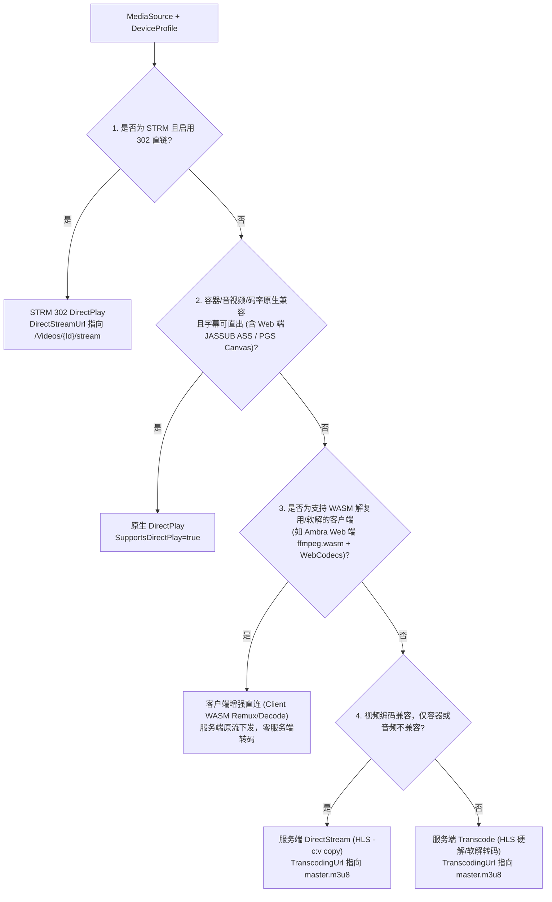

# 03. 播放决策、动态 HLS 转码与字幕处理规格

[← 返回文档中心](../README.md)

本文档定义 `PlaybackInfo` 决策引擎、STRM 302 重定向、FFmpeg 动态 HLS 切片数学模型、硬件加速参数拼装及主流客户端兼容要点。

---

## 1. `POST /Items/{Id}/PlaybackInfo` 五级智能播放决策算法

核心原则：**尽一切可能避免不必要的服务端转码**。收到客户端请求（含 `DeviceProfile`、`MaxStreamingBitrate`、`AudioStreamIndex`、`SubtitleStreamIndex`、`StartTimeTicks`）后，对每个 `MediaSource` 按以下五级优先级决策：

### 关键细节
- **ASS / PGS 零转码策略**：Ambra 自研 Web 端（详见 [06-web-client-and-player.md](06-web-client-and-player.md)）接入 **JASSUB（ASS/SSA WASM）** 与 **PGS Canvas 渲染器**，在 `DeviceProfile.SubtitleProfiles` 中将 `ass`/`ssa`/`pgssub` 声明为 `External` 直出。决策引擎识别后直接下发原始字幕轨道与内嵌字体附件，**绝不因选了 ASS 或 PGS 字幕而触发服务端视频重编码**；仅当老旧第三方客户端明确声明不支持时才降级硬烧。
- **客户端 WASM 能力协商**：当浏览器环境满足 `SharedArrayBuffer` / WebCodecs 条件且码率在客户端承受范围内时，优先走客户端 `ffmpeg.wasm` 轻量转封装（如 MKV → fMP4）或音频软解；否则自动无感回退到服务端 DirectStream / Transcode。
- **多版本选择**：若请求指定 `MediaSourceId` 则只评估该版本；否则返回全部可用 `MediaSources`，并将最匹配客户端能力（优先 DirectPlay）的排在首位。
- **PlaySessionId**：每次 `PlaybackInfo` 分配唯一 `PlaySessionId`（32 位 hex），串联后续 `master.m3u8`、切片请求、`/Sessions/Playing/*` 与 `DELETE /Videos/ActiveEncodings`。

---

## 2. STRM 与 302 直链策略

针对网盘/远端媒体场景，Ambra 原生内置 STRM 302 引擎（无需再套一层 nginx/Emby2Alist）：
- 读取 `.strm` 文件内的真实 URL（支持 `http://` / `https://`、URL 编码归一化、可选规则替换或调用 WASM/HTTP `StreamResolver` 动态签发直链）。
- 当客户端请求 `/Videos/{Id}/stream`、`/Videos/{Id}/original.*` 或 `/Items/{Id}/Download` 时：
  - 若命中 302 策略，直接返回 `302 Found` + `Location: <直链>` + `Cache-Control: no-store`。
  - 若客户端显式需要转码（`TranscodingUrl`），则由服务端 FFmpeg 直接拉取该直链作为输入（带自定义 `User-Agent` / `Headers`）进行转码输出。

---

## 3. 动态 HLS 虚拟分片模型（秒开 + 任意拖动 Seek）

浏览器和部分移动端通过 HLS（`master.m3u8` → `main.m3u8` → `hls1/main/{idx}.ts`）播放时，**不能等 FFmpeg 从头转码到第 45 分钟**。Ambra 采用与 Emby 一致的**虚拟完整播放列表 + 按需 Seek 转码模型**：

1. **立即生成完整 `main.m3u8`**：
   - 已知视频总时长 $D$（秒）与固定切片时长 $S$（默认 `3` 秒或 `6` 秒），总切片数 $N = \lceil D / S \rceil$。
   - 请求 `main.m3u8` 时立即生成包含 `0` 到 `N-1` 全部切片 URL 的 VOD 播放列表（`#EXT-X-ENDLIST`），客户端播放器立刻看到完整进度条，可随时拖动到任意位置。
2. **按需切片调度（`GET /Videos/{Id}/hls1/{PlaylistId}/{SegmentId}.ts`）**：
   - **命中缓存**：若磁盘上 `seg_{idx}.ts` 已完整写入（通过原子重命名 `.tmp -> .ts` 保证完整），直接流式返回。
   - **顺序等待**：若当前正在运行的 FFmpeg 进程已转到 `idx - 2 .. idx`，阻塞等待该切片落盘（带 `context` 超时）后立即返回。
   - **随机拖动（Seek）**：若请求的 `idx` 远大于当前转码进度或小于当前起点，立即终止旧 FFmpeg 进程，以 `-ss <idx * S>` 参数启动新 FFmpeg，设置 `-start_number <idx>` 从目标切片开始生成！
3. **转码限速（Throttling）**：
   - 当已超前客户端播放位置超过阈值（如提前生成了 60 秒切片）时，通过暂停读取/信号或分段休眠节流，避免占满 CPU/磁盘。
4. **自动回收**：
   - 会话空闲超过 `TranscodeIdleTimeout`（默认 60 秒）或收到 `DELETE /Videos/ActiveEncodings` / `/Sessions/Playing/Stopped` 时，杀掉进程并清理临时目录。

---

## 4. 硬件加速与色调映射（`/Encoding/*`）

服务启动时自动运行 `ffprobe` / `ffmpeg -hwaccels` + 测试编码探测本机可用加速能力，并映射到 `/Encoding/CodecInformation/Video`：

| 平台 | 解码/编码器 | HDR → SDR 色调映射 |
| :--- | :--- | :--- |
| **Linux Intel/AMD (VAAPI)** | `h264_vaapi` / `hevc_vaapi` | `tonemap_vaapi` 或 `tonemap_opencl` |
| **Linux Intel (QSV)** | `h264_qsv` / `hevc_qsv` | `vpp_qsv=tonemap=1` |
| **Linux/Win NVIDIA (NVENC)** | `h264_nvenc` / `hevc_nvenc` | `tonemap_cuda` |
| **macOS Apple Silicon** | `h264_videotoolbox` / `hevc_videotoolbox` | `zscale` + `tonemap`（CPU 回退） |
| **通用软解回退** | `libx264` / `libx265` | `zscale` + `tonemap=hable` |

---

## 5. 字幕处理与简繁中文增强

- **简繁自动识别**：扫描外挂字幕文件名与内封字幕 `title/language` 元数据：
  - 匹配 `chs / sc / gb / hans / 简` → `sub_variant = "chs"`，展示为 `简体中文 (SRT/ASS)`。
  - 匹配 `cht / tc / big5 / hant / 繁` → `sub_variant = "cht"`，展示为 `繁体中文 (SRT/ASS)`。
  - 同时匹配简繁或 `双语/特效` → 标注 `简繁双语`。
- **格式实时转换**：`/Videos/{Id}/{MediaSourceId}/Subtitles/{Index}/Stream.{Format}` 支持：
  - 原格式直出（`.srt` / `.ass` / `.ssa` / `.vtt`）；
  - 客户端请求 `.vtt` 而源文件是 `.srt`/`.ass` 时，纯 Go 实时转换为 WebVTT（带 `StartPositionTicks` 时间偏移修正，兼容 HLS Seek）。
  - 客户端请求 `.js`（Emby Web 专用 JSON 字幕格式）时，解析时间轴并输出 `SubtitleTrackInfo` JSON。

---

## 6. 主流客户端常见兼容坑位清单

| 客户端 | 关键兼容点 |
| :--- | :--- |
| **Infuse** | 强依赖 `MediaSources[0].Path`、`ETag` 增量同步、`/Users/{UserId}/Items` 的 `Fields=DateCreated,Etag,Genres,MediaSources,Overview,ParentId,Path,People,ProviderIds,SortName,RecursiveItemCount` |
| **VidHub / SenPlayer** | 依赖 `/Videos/{Id}/stream` 的 HTTP `Range` 与 `302` 重定向、`PlaybackInfo` 中的 `DirectStreamUrl`、外挂字幕 URL 拼接规则 |
| **Emby 官方 Web / App** | 依赖 `/System/Info` 完整字段、`/Registrations/{Name}`、WebSocket 心跳、`DisplayPreferences` 与 `SubtitleTrackInfo` (`.js`) |
| **Kodi (Emby-next-gen)** | 重度依赖 WebSocket `LibraryChanged`、`UserDataChanged` 与 `/Sync` / `/Items` 的 `MinDateLastSaved` 增量拉取 |
