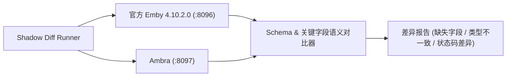

# 05. 契约测试、影子对比与性能基准规格

[← 返回文档中心](../README.md)

为了确保“100% 兼容 Emby 4.10.2.0 的 582 条 API”不是口头目标，而是可自动化验证的工程质量门禁，Ambra 从 Phase 0 起即建立三层测试与验证体系。

---

## 1. 第一层：582 条路由全量契约清单测试（`tests/compat`）

直接以 `emby-4.10.2.0-api` 的结构化路由清单为基准，编写自动化扫描测试：
1. **路由注册完整性断言**：遍历 Ambra 路由器（`chi.Walk`），校验全部 582 条 `(Method, Path)` 在 `/` 和 `/emby/` 下均已注册，任何缺失或方法不匹配直接 CI 失败。
2. **鉴权矩阵自动测试**：
   - 对 521 条需认证路由：不带 Token 请求必须返回 `401`；普通用户 Token 请求 Admin 路由必须返回 `403`。
   - 对 61 条公开路由：不带 Token 请求不得返回 `401/403`。
3. **兼容细节回归测试**：
   - 路径大小写混写（`/EMBY/users/public`）
   - Query Key 大小写混写（`?userid=...&includeitemtypes=Movie,Series`）
   - 32 位无横杠 GUID 与 36 位带横杠 UUID 互换
   - JSON 字段 PascalCase 命名与空切片 `[]`（非 `null`）断言

---

## 2. 第二层：官方 4.10.2.0 影子对比测试（Shadow Diff）

在本地测试环境中同时启动 **官方 Emby Server 4.10.2.0** 与 **Ambra**，指向同一份标准测试媒体夹（`tests/fixtures`，含电影、多季剧集、多版本、外挂简繁字幕、STRM、音乐、图片）：

- **对比策略**：忽略动态字段（如 `ServerId`, `Id`, `DateCreated`, `AccessToken`），严格校验：
  - HTTP 状态码与 `Content-Type`；
  - 响应 JSON 的顶层与嵌套 Key 集合（检测 Ambra 是否漏掉客户端依赖的字段）；
  - 字段数据类型一致性（`string` vs `int` vs `bool` vs `array`）。

---

## 3. 第三层：主流真实客户端验收矩阵

每个里程碑发布前，必须通过以下真实客户端与生态工具的端到端实测：

| 类别 | 目标客户端 / 工具 | 核心验收场景 |
| :--- | :--- | :--- |
| **Apple 生态** | **Infuse** / **VidHub** / **SenPlayer** / **Fileball** | 登录、全量同步海报墙、多版本切换、STRM 302 直连、外挂简繁字幕、播放进度与已看同步 |
| **官方客户端** | **Emby Web** / **Emby iOS & Android** / **Android TV** | 首页推荐、继续观看、中文模糊搜索、动态 HLS 转码拖动、远程遥控、管理后台设置 |
| **开源播放器** | **Kodi (Emby-next-gen)** / **Hills** / **Yamby** | WebSocket 实时增量同步、合集与筛选器浏览、音乐播放 |
| **自动化工具** | **MoviePilot** / **Sonarr** / **Radarr** | API Key 鉴权、入库通知 `/Library/Media/Updated`、媒体库刷新、Webhook 回调 |

---

## 4. 性能与资源基准目标（v1.0.0 门槛）

在 4 核 CPU / 4GB 内存（典型 NAS / 轻量 VPS）与 **50 万条媒体记录（含电影 + 剧集分集）** 的压测数据集下：

| 指标 | 目标值 |
| :--- | :--- |
| 空载常驻内存（RSS） | `< 60 MB` |
| 首页 `/Users/{Id}/Views` + `Latest` + `Resume` 响应 P95 | `< 50 ms` |
| 中文多词乱序 / 拼音搜索（`/Search/Hints`）P95 | `< 20 ms` |
| 50 万条目增量扫库（无文件变更）耗时 | `< 30 s` |
| DirectPlay / STRM 302 并发吞吐 | 跑满网卡或受限于磁盘 I/O，CPU 占用 `< 10%` |
| SQLite 并发读写（扫库同时 50 客户端浏览） | `0` 次 `SQLITE_BUSY` 报错 |
