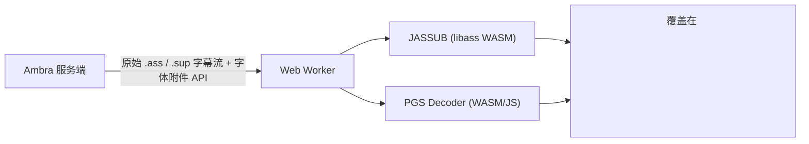

# 06. 现代 Web 客户端与零转码播放器规格

[← 返回文档中心](../README.md)

Ambra 的**首个可用版本（v0.1 / Phase 1）**即内置一个开箱即用的现代 Web 网页版客户端（通过 Go `embed.FS` 编译进单二进制，同时支持挂载外部目录覆盖）。页面信息架构参考 Emby，让老用户零学习成本上手，但视觉与交互全面现代化，并重点解决浏览器端“动不动就触发服务端转码”的痛点。

---

## 1. 前端技术栈与工程设计

| 模块 | 选型 | 理由 |
| :--- | :--- | :--- |
| **框架与构建** | **React 19 / Vue 3 + TypeScript + Vite** | 生态成熟、打包体积小，产物直接 `embed.FS` 嵌入 Go 二进制 |
| **样式与组件** | **Tailwind CSS + Radix UI / Headless UI** | 现代暗色影院主题、高对比度可读性、丝滑过渡动画与键盘无障碍支持 |
| **状态与缓存** | **TanStack Query (React Query)** | 列表/详情缓存、后台静默刷新、乐观更新（点收藏/标已看零延迟响应） |
| **视频播放内核** | 原生 `<video>` + `hls.js` + `mpegts.js` + **WebCodecs / `ffmpeg.wasm`** | 最大化利用浏览器硬解与客户端解封装，显著减少服务端转码 |
| **ASS/SSA 字幕** | **JASSUB**（`libass` WASM + Web Worker + `OffscreenCanvas`） | 浏览器端原生像素级渲染 ASS 特效、卡拉 OK、矢量绘图与内嵌字体，**不触发服务端烧录转码** |
| **PGS 图形字幕** | **pgs-renderer / libpgs-wasm**（Canvas 叠加层） | 直接解码蓝光 `.sup` / PGS 轨道并同步绘制到视频上方，**不触发服务端转码** |
| **文本字幕** | 原生 VTT / 自定义样式渲染器 | 支持字体大小、阴影、位置、时间轴偏移实时微调与双语样式 |

---

## 2. 页面布局与交互设计（参考 Emby，体验更现代）

保留 Emby 用户熟悉的功能分区，优化视觉层次与操作效率：

1. **全局框架**
   - 左侧可折叠导航栏（首页、各媒体库、收藏、直播、同步、管理控制台）+ 顶部毛玻璃搜索栏（支持 `Cmd/Ctrl + K` 唤起全局即时中文乱序/拼音搜索）。
   - 响应式自适应：桌面端、平板与手机浏览器均有一流布局；支持遥控器/键盘方向键导航。
2. **首页（Home）**
   - 顶部全宽轮播推荐 Banner（高亮新入库/高分影片 Backdrop + 简介 + 一键播放）。
   - 分区横滑卡片行：**我的媒体** → **继续观看（带进度条与一键下一集）** → **各媒体库最新添加**。
3. **媒体库浏览页（Library View）**
   - 顶部轻量筛选栏（流派、年份、分辨率/HDR、音视频编码、是否已看、排序方式）+ 字母索引跳转条 + 虚拟滚动海报墙（万级海报流畅不卡顿）。
4. **详情页（Item Detail）**
   - 沉浸式大背景图（自动提取主色调渐变融合）+ 海报 + 评分（TMDB/豆瓣/IMDb）+ 技术徽章（4K / Dolby Vision / Atmos / 简繁字幕标识）。
   - 直接在播放按钮旁提供**多版本切换、音轨选择、字幕选择（明确标出简体/繁体/双语/ASS/PGS）**。
   - 剧集页内置季切换 Tab 与带剧照/进度的分集列表；下方展示演职员横滑、相关推荐与合集。
5. **沉浸式播放器（OSD）**
   - 快捷键（空格暂停、左右快进、上下音量、F 全屏、C 切字幕、A 切音轨）、播放速度、片头跳过按钮、画面比例切换、**实时播放统计面板（显示 DirectPlay / WASM Remux / Transcode、码率、解码器、字幕渲染引擎）**。
6. **现代管理后台（Dashboard）**
   - 实时活动会话卡片、媒体库与路径管理、**插件市场与配置页（含刮削器优先级拖拽）**、硬件转码检测面板、计划任务实时进度条、日志在线检索与配置备份还原。

---

## 3. 客户端零转码字幕与 WASM FFmpeg 架构

### 3.1 ASS / PGS 客户端直出渲染管线

- **字幕零转码声明**：Ambra Web 客户端在调用 `/Items/{Id}/PlaybackInfo` 时，在其 `DeviceProfile.SubtitleProfiles` 中显式声明 `ass`、`ssa`、`pgssub` 为 `DeliveryMethod: External`（外挂直出），服务端便**不会**因选中 ASS 或 PGS 而强制降级为视频硬烧转码。
- **字体按需加载**：服务端提供内嵌字体提取缓存接口，JASSUB 按需拉取 MKV 附件字体（或回退到内置中文字体包），保证动漫特效字幕还原度接近本地播放器。

### 3.2 客户端 `ffmpeg.wasm` / WebCodecs 轻量解复用与软解
对于浏览器原生 `<video>` 不直接支持的情况（例如 **MKV 容器封装的 H.264/HEVC**，或 **AC3 / EAC3 / DTS 音轨**），在触发服务端重度转码前增加一层**客户端增强直连**：
1. **MKV 客户端即时转封装（Remux）**：通过 HTTP Range 分块拉取媒体流，在 Web Worker 中使用轻量 WASM 解复用器（`ffmpeg.wasm` 精简构建或专用 demuxer）将 MKV 转为 fMP4 喂给 MSE（MediaSource Extensions），视频流零重编码。
2. **音频客户端软解**：当视频编码浏览器原生支持但音频是 AC3/DTS 时，由 WASM 解码器在前端解出 PCM 通过 WebAudio 播放，避免服务端转码。
3. **工程边界与自动降级（关键务实约束）**：
   - 多线程 `ffmpeg.wasm` 依赖 `SharedArrayBuffer`，要求服务端在 `/web/*` 下发 `Cross-Origin-Opener-Policy: same-origin` 与 `Cross-Origin-Embedder-Policy: require-corp` 响应头（需确保不阻断第三方海报图片/外链，外链资源统一经由 Ambra 图片代理同源返回）。
   - 在低配手机、非 HTTPS 局域网环境（无 `SharedArrayBuffer`）或超高码率（如 80Mbps 原盘 HEVC 软解）下，播放器自动检测能力并**无感回退到服务端 DirectStream / HLS 转码**，保证任何设备都能秒开流畅播放。
